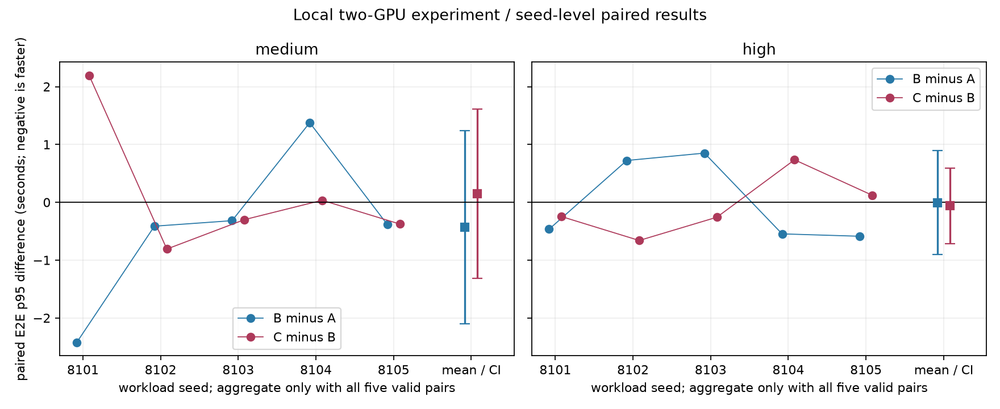

# 运行中 KV 迁移增量收益实验

本目录保存 2026-10-27 至 2026-10-28 完成的本地双 GPU 实验结果。A 仅动态路由；B 增加从未开始执行的等待请求转移；C 完整复用 B，再增加周期性运行中 KV 迁移。

正式实验共 30 轮，22,953/22,953 个请求完成，失败 0、截止未完成 0。A/B/C 使用相同请求清单、到达时间和生成参数，按 5 个工作负载种子配对比较。

## 主要结果

| 负载 | B−A E2E p95 | 95% 配对区间 | C−B E2E p95 | 95% 配对区间 |
|---|---:|---:|---:|---:|
| medium，0.5 请求/秒 | −0.433 秒 | [−2.105, +1.239] | +0.149 秒 | [−1.318, +1.616] |
| high，2 请求/秒 | −0.005 秒 | [−0.906, +0.896] | −0.062 秒 | [−0.713, +0.589] |

负值表示更快。两个负载下 C−B 的区间都包含 0，因此本次没有获得运行中迁移稳定降低整轮 E2E p95 的证据。这不证明所有运行中迁移都无价值。

C 在正式轮次中选中 39 次运行迁移：37 次完成、1 次因请求正常完成而取消、1 次未发起，用户失败为 0。B/C 共尝试 17 次等待请求转移，全部在 EngineCore 原子复核时发现请求已经开始执行，因此安全拒绝，成功提交为 0。

18,404 对 A/B、B/C 同 ID 完整输出的 token IDs 和 finish reason 全部一致。正式请求中 207 个以 `finish_reason=length` 结束，说明这些请求达到 4,096 token 输出预算，不能称为完全无限制自然生成。



## 文件入口

- [中文 HTML 报告](report.html)
- [结论摘要](FINDINGS.md)
- [最终交叉核对](FINAL_REVIEW.md)
- [逐轮指标](summary.csv)
- [逐种子配对差值](paired_round_differences.csv)
- [配对不确定性](paired_seed_uncertainty.csv)
- [全部请求记录](request_metrics.csv)
- [迁移会话与客户端结果对应](migration_sessions.csv)
- [迁移期间输出块停顿](migration_request_effects.csv)
- [等待转移原子拒绝证明](waiting_atomic_rejection_proofs.csv)
- [实际执行位置](execution_locations.csv)
- [输出一致性逐请求核对](output_comparisons.csv)
- [冻结协议](FROZEN_PROTOCOL_05.md)
- [环境与版本](ENVIRONMENT.md)
- [复核与复现说明](REPRODUCE.md)
- [失败、污染与补跑台账](RUN_LEDGER.csv)
- [退出故障说明](OPEN_ISSUES.md)

`report.html` 引用各轮目录下的状态和 GPU 功率图。GitHub 网页可能把 HTML 显示为源码；下载本目录后直接在浏览器打开即可完整查看。

## 数据完整性与范围

冻结运行源码 20/20 个 SHA256 一致；迁移会话与原生日志全部对应；迁移 block lease 无未归还或重复归还；测量窗口内未记录外来 GPU 进程。详见 `final_audit/` 和 `final_review.json`。

完整服务器原始包未放入 Git，避免把约 1.7 GB 的服务日志、状态流和监控原文写入仓库历史。原始包文件名为 `incremental_runtime_migration_20261027_01_raw_20261028_01.tar.gz`，大小 1,718,242,987 字节，SHA256：

```text
04e3fabb91f9e9e14c03481e0e74e5555508b7ad609faef907d201137a56608d
```

本目录是从已校验的派生交付中整理出的可复核副本。请求级 CSV、图、审计结果、冻结参数和分析结论均保留；原始服务日志和 GDB 证据仍保存在实验归档中。

## 已知退出问题

所有测量完成后，目标实例在 Asio `doAccept` 回调路径发生 segfault，源实例报告 `corrupted double-linked list`。两张 GPU 和全部实验进程最终均已释放，但严格的正常卸载验收没有通过，根因也尚未证实。本目录不声称该退出问题已修复；详细证据边界见 [OPEN_ISSUES.md](OPEN_ISSUES.md)。

结论只适用于本地双 RTX 5090、Qwen2.5-7B-Instruct、这里的两个负载和冻结的简单控制规则，不外推为跨数据中心结果或所有运行迁移策略的结论。
